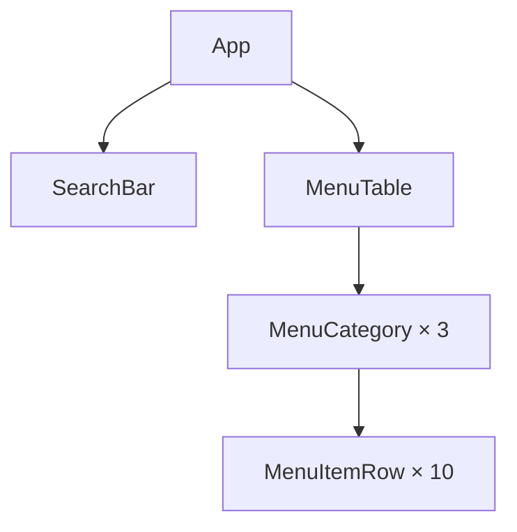

# ЛР-3. Рефакторинг за деревом компонентів

Стартовий проєкт лабораторної роботи № 3 курсу «Розробка вебзастосунків на React»: сторінка «Меню кав'ярні».

## 1. Ієрархія компонентів (Mermaid)



## 2. Дерево рендерингу

```
App
├── SearchBar
└── MenuTable
    ├── MenuCategory (key="coffee")
    │   ├── MenuItemRow (key=1)
    │   ├── MenuItemRow (key=2)
    │   ├── MenuItemRow (key=3)
    │   └── MenuItemRow (key=4)
    ├── MenuCategory (key="tea")
    │   ├── MenuItemRow (key=5)
    │   ├── MenuItemRow (key=6)
    │   └── MenuItemRow (key=7)
    └── MenuCategory (key="desserts")
        ├── MenuItemRow (key=8)
        ├── MenuItemRow (key=9)
        └── MenuItemRow (key=10)
```

## 3. Дерево залежностей модулів

```
main.jsx
├── index.css
└── App.jsx
    ├── components/SearchBar.jsx
    ├── components/MenuTable.jsx
    │   └── components/MenuCategory.jsx
    │       └── components/MenuItemRow.jsx
    └── data.js
```

## 4. Стан

Для кожного рядка таблиці дайте відповідь на три питання з кроку 3 Thinking in React (§4.7):

1. Чи залишаються ці дані незмінними з часом? Якщо так, це не стан.
2. Чи передаються вони від батьківського компонента через пропси? Якщо так, це не стан.
3. Чи можна обчислити їх на основі наявного стану чи пропсів? Якщо так, це точно не стан.

| Дані                                           | Стан? | Чому                                                                  |
| :--------------------------------------------- | :---- | :-------------------------------------------------------------------- |
| меню: категорії й позиції (`menu`)             | Ні    | Дані приходять із `data.js` і є статичними вхідними даними.           |
| текст у полі пошуку                            | Так   | Змінюється внаслідок введення користувачем, не може бути обчислений.  |
| значення прапорця «Лише в наявності»           | Так   | Змінюється користувачем через взаємодію з чекбоксом.                  |
| позиції, що залишаться після фільтрування      | Ні    | Обчислюються динамічно на основі пошукового запиту та стану чекбокса. |
| кількість позицій у заголовку категорії, «(4)» | Ні    | Обчислюється автоматично на основі `category.items.length`.           |

Стан житиме в компоненті: `App`, бо він є найближчим спільним предком для `SearchBar` та `MenuTable`, яким потрібні ці дані для фільтрації та відображення.
