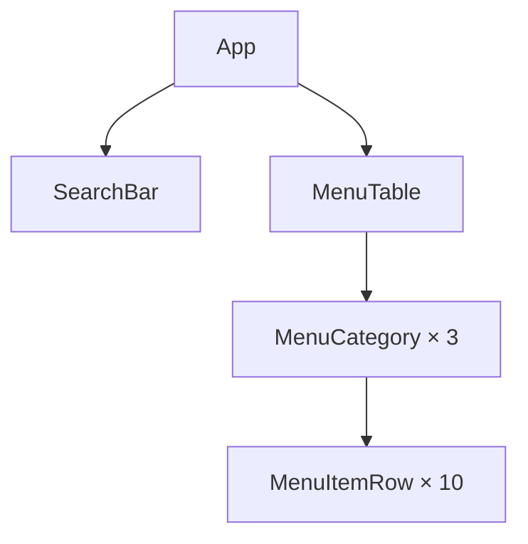

# ЛР-3. Рефакторинг за деревом компонентів

Стартовий проєкт лабораторної роботи № 3 курсу «Розробка вебзастосунків на React»: сторінка «Меню кав'ярні».

## Команди

`npm install` виконуйте в корені репозиторію `react-labs`, решту — у теці `lab-3/`:

- `npm run dev`: dev-сервер на http://localhost:5173
- `npm run lint`: ESLint
- `npm run format:check`: перевірка форматування Prettier
- `npm run build`: production-збірка в `dist/`

## 1. Ієрархія компонентів (Mermaid)

## 2. Стан

Для кожного рядка таблиці дайте відповідь на три питання з кроку 3 Thinking in React (§4.7):

1. Чи залишаються ці дані незмінними з часом? Якщо так, це не стан.
2. Чи передаються вони від батьківського компонента через пропси? Якщо так, це не стан.
3. Чи можна обчислити їх на основі наявного стану чи пропсів? Якщо так, це точно не стан.

| Дані                                           | Стан? | Чому |
| :--------------------------------------------- | :---- | :--- |
| меню: категорії й позиції (`menu`)             |       |      |
| текст у полі пошуку                            |       |      |
| значення прапорця «Лише в наявності»           |       |      |
| позиції, що залишаться після фільтрування      |       |      |
| кількість позицій у заголовку категорії, «(4)» |       |      |

Стан житиме в компоненті: … , бо …
