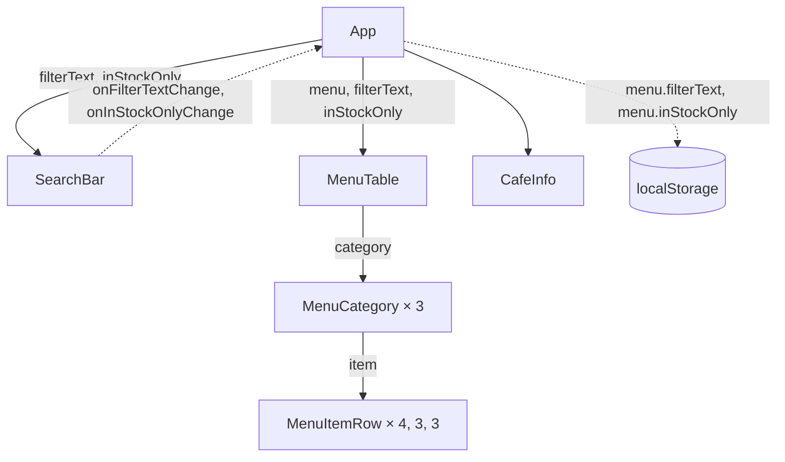

# ЛР-4. Стан і ефекти

Стартовий проєкт лабораторної роботи № 4 курсу «Розробка вебзастосунків на
React»: сторінка «Меню кав'ярні». Інструкція:
https://denysmatsevych.github.io/web-development-2026/react/labs/lab-4/

Компоненти вже винесено в теку `src/components/`, але сторінка поки лише
показує дані: поле пошуку й прапорець нічого не роблять. Ви додасте стан
(`useState`), щоб вони запрацювали, і збережете фільтри між
перезавантаженнями сторінки (`useEffect`). Функція фільтрування лежить у
`src/filterMenu.js`, дані меню — у `src/data.js`, стилі — у `src/index.css`.

## Команди

`npm install` виконуйте в корені репозиторію `react-labs`, решту — у теці
`lab-4/`:

- `npm run dev`: dev-сервер на http://localhost:5173
- `npm run lint`: ESLint
- `npm run format:check`: перевірка форматування Prettier
- `npm run build`: production-збірка в `dist/`

## Потік даних

Діаграма показує, як дані рухаються між компонентами. Суцільна стрілка —
пропси, які батьківський компонент передає дочірньому; пунктирна — зворотний
потік: виклик функції-обробника вгору або запис у сховище поза React.
GitHub показує цей блок діаграмою; перевірити її до `git push` можна в
https://mermaid.live/.

