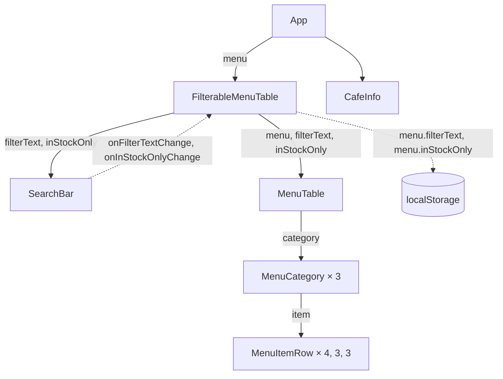

# ЛР-4. Стан і ефекти

Стартовий проєкт лабораторної роботи № 4 курсу «Розробка вебзастосунків на
React»: сторінка «Меню кав'ярні». Інструкція:
https://denysmatsevych.github.io/web-development-2026/react/labs/lab-4/

Компоненти винесено в теку `src/components/`. Поле пошуку й прапорець
фільтрують меню, а стан фільтрів (`useState`) зберігається в `localStorage`
між перезавантаженнями сторінки (`useEffect`). Функція фільтрування лежить у
`src/filterMenu.js`, дані меню — у `src/data.js`, стилі — у `src/index.css`.

## Команди

Усі команди виконуйте в теці `lab-4/`:

- `npm run dev`: dev-сервер на http://localhost:5173
- `npm run lint`: ESLint
- `npm run format:check`: перевірка форматування Prettier
- `npm run build`: production-збірка в `dist/`

## Потік даних

Діаграма показує, як дані рухаються між компонентами. Суцільна стрілка —
пропси, які батьківський компонент передає дочірньому; пунктирна — зворотний
потік: виклик функції-обробника вгору або запис у сховище поза React.
GitHub показує цей блок діаграмою; перевірити її до `git push` можна в
https://mermaid.live/.

## Колокація стану

Стан фільтрів перенесено з `App` у `FilterableMenuTable` (§4.7). Під час
введення тексту в поле пошуку рендерилися такі компоненти:

**До:**

- `App`
- `SearchBar`
- `MenuTable`
- `MenuCategory` × 3
- `MenuItemRow` × 10
- `CafeInfo`

**Після:**

- `FilterableMenuTable`
- `SearchBar`
- `MenuTable`
- `MenuCategory` × 3
- `MenuItemRow` × 10

`App` і `CafeInfo` більше не рендеряться, бо стан живе нижче в дереві й
їхні пропси не змінюються.
