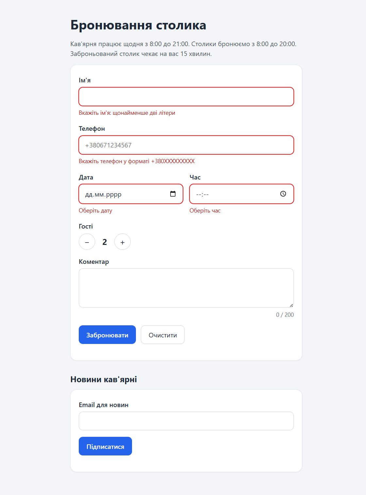
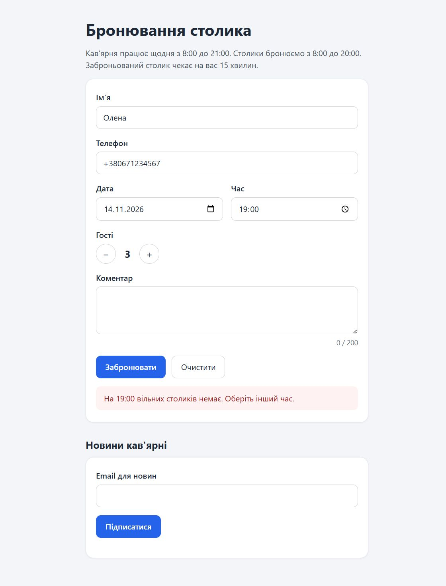

# ЛР-6. Складні форми та валідація — звіт

Тема листа: `[React] ЛР-6: складні форми та валідація`

GitHub repository: https://github.com/andriihnatenko-ux/react-labs/tree/main/lab-6

Vercel: https://react-lab-6.vercel.app/ (замініть на адресу свого проєкту після
деплою)

Версія з іншими бібліотеками: https://github.com/andriihnatenko-ux/react-labs/tree/main/lab-6-alt,
порівняння — у `lab-6-alt/README.md`, Vercel: https://react-lab-6-alt.vercel.app/
(замініть на адресу свого проєкту після деплою).

## 1. Форма після надсилання з порожніми полями

Усі чотири повідомлення видно одразу, рамки полів червоні, курсор у полі
«Ім'я».



## 2. Відповідь сервера на 19:00

Сервер відмовляє, а значення лишаються в полях.



## 3. Перевірки

`npm run lint` — без помилок і попереджень, `npm run format:check` — усі файли
відформатовані, `npm run build` — збірка успішна.

```
> lab-6@0.0.0 lint
> eslint .

> lab-6@0.0.0 format:check
> prettier . --check

Checking formatting...
All matched files use Prettier code style!

> lab-6@0.0.0 build
> vite build

vite v8.3.8 building client environment for production...
✓ 120 modules transformed.
dist/index.html                   0.49 kB │ gzip:   0.35 kB
dist/assets/index-C1bXEvUn.css    2.85 kB │ gzip:   1.00 kB
dist/assets/index-BZs9kHKu.js   353.69 kB │ gzip: 109.37 kB
✓ built in 202ms
```

Для `lab-6-alt` ті самі три команди проходять так само; JS-файл збірки —
359.17 kB (gzip 111.51 kB).

## 4. §4.7 — форма підписки без бібліотек

Виконано. `src/components/SubscribeForm.jsx`: `<form action={formAction}>`,
`useActionState`, окремий `SubmitButton` із `useFormStatus` (кнопка показує
«Підписуємо…»), email перевіряє `z.email()` усередині дії. Неправильна й
зайнята адреси лишаються в полі (`defaultValue={state?.email}`), після успіху
поле порожнє — React очищає неконтрольовані поля сам.

## 5. §4.8 — та сама форма з іншими бібліотеками

Виконано в `lab-6-alt/`: React Hook Form замінено на **Formik 2.4.9**, Zod для
схеми бронювання — на **Yup 1.7.1** (Zod 4.6.7 лишився тільки для форми
підписки). Порівняння, таблиця відповідників, розміри збірки, рендери під час
введення й дати релізів — у `lab-6-alt/README.md`.

## 6. Використання AI

Використовував AI-агента (OpenCode) для чернеток коду й перевірок.

## 7. Висновок

Зроблено: схема Zod з правилами для кожного поля й окремим правилом для двох
полів (дата + час), React Hook Form із `register`, `Controller` і `useWatch`,
повідомлення під полями з `aria-invalid` і `aria-describedby`, надсилання через
`useActionState` зі станом очікування й очищенням після успіху, форма підписки
на `<form action>`, версія з Formik і Yup, деплой на Vercel.

Складним було: змусити повідомлення про минулий час зникати після зміни дати
(у React Hook Form для цього потрібен `trigger('time')` в `onChange` дати), а
також зрозуміти, чому після `await` усередині дії `reset()` треба знову
загортати в `startTransition`. У версії з Formik найбільше часу забрав фокус
на першій помилці: Formik не має ні `setFocus`, ні повернення помилок із
`submitForm()`, тож довелося перевіряти форму через `validateForm()` і самим
позначати всі поля «торкнутими».
