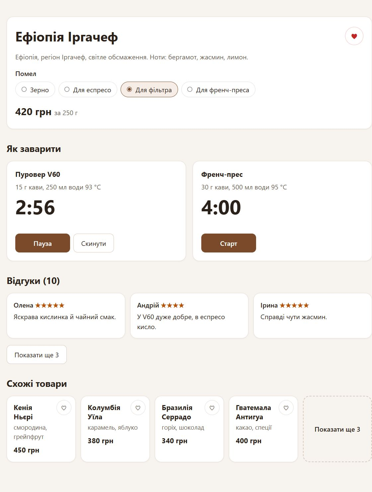
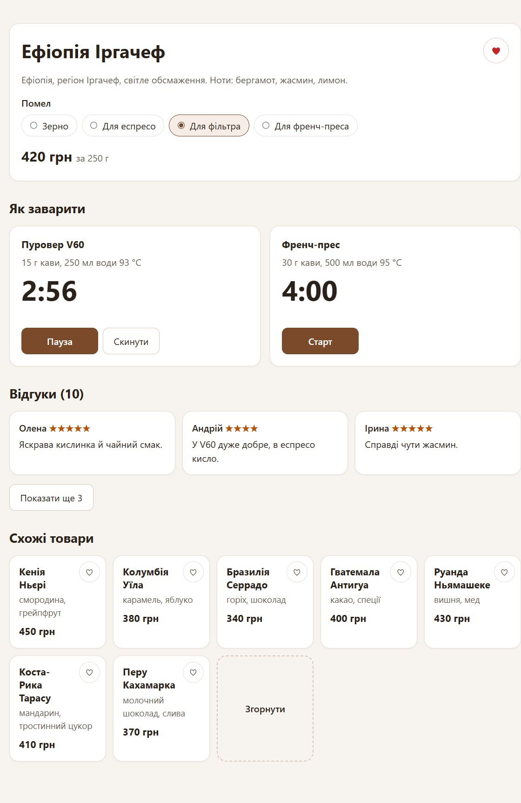

# ЛР-7. Власні хуки, розумні й прості компоненти, render props — звіт

Тема листа: `[React] ЛР-7: власні хуки, розумні й прості компоненти, render props`

GitHub repository: https://github.com/andriihnatenko-ux/react-labs/tree/main/lab-7

Vercel: https://react-lab-7.vercel.app/ (адреса після деплою проєкту з Root
Directory `lab-7`)

## 1. Сторінка після §4.3–§4.6

♥ натиснуто, помел «Для фільтра» (у localStorage — JSON-рядок `"filter"`),
«Пуровер V60» іде відліком і показує «Пауза» та «Скинути», «Френч-прес» ще не
запущено, у відгуках три картки й кнопка «Показати ще 3».



## 2. Кнопка «Схожі товари» — остання клітинка сітки

Після «Показати ще 3» у сітці сім карток, а восьма клітинка з пунктирною
рамкою містить «Згорнути». Фокус після натискання лишається на цій кнопці, бо
`<li>` має стабільний `key`, а кнопка — той самий DOM-елемент.



## 3. Перевірки

`npx vitest run` — 41 тест з 41; `npm run lint` — без помилок і попереджень;
`npm run format:check` — усі файли відформатовані; `npm run build` — збірка
успішна.

```
 RUN  v5.1.0 D:/REACT/lab-7

 Test Files  5 passed (5)
      Tests  41 passed (41)

> lab-7@0.0.0 lint
> eslint .

> lab-7@0.0.0 format:check
> prettier . --check

Checking formatting...
All matched files use Prettier code style!

vite v8.3.8 building client environment for production...
✓ 30 modules transformed.
dist/index.html                   0.48 kB │ gzip:  0.33 kB
dist/assets/index-71mfzt7D.css    3.38 kB │ gzip:  1.16 kB
dist/assets/index-DmSRcfKd.js   226.94 kB │ gzip: 71.54 kB
✓ built in 122ms
```

Історія комітів:

```
chore: add lab 7 starter
refactor: extract the useLocalStorage hook
feat: split the timer into a container and TimerView
fix: move the countdown into useCountdown
refactor: share the show-more logic through a render prop
feat: put the related products button into the grid
```

## 4. Що було не так і що змінено

**§4.3. useLocalStorage.** У `FavoriteButton` і `GrindPicker` були дві копії
логіки `useState` + `useEffect`, причому ♡ писався рядком, а помел — без
перетворення, тож старе значення `filter` не читалося як JSON. Винесено хук
`useLocalStorage(key, initialValue)`: лінивий ініціалізатор із `try/catch`
навколо `JSON.parse`, запис через `JSON.stringify`, повертає
`[value, setValue]` як `useState`. Обидва компоненти тепер беруть стан із
нього.

**§4.4. TimerView і BrewTimer.** `BrewTimer` показував усі три кнопки завжди й
змішував стан, ефект і розмітку. Додано простий `TimerView` без хуків: він
отримує `method`, `secondsLeft`, `status` та обробники й умовним рендерингом
показує кнопки для `idle`, `running`, `paused`, `done`. `BrewTimer` став
розумним: визначає `status` і рендерить `TimerView`. Перша кнопка — той самий
елемент у всіх станах, тому фокус не губиться; `role="status"` є на сторінці
від початку.

**§4.5. useCountdown.** Старий ефект не очищав `setInterval`, читав
застарілий `secondsLeft` і не зупинявся на нулі — ESLint попереджав про
відсутню залежність. Відлік перенесено в `useCountdown`: інтервал створюється
в ефекті з `return () => clearInterval(id)`, час оновлюється функцією
`setSecondsLeft((s) => Math.max(0, s - 1))`, а активність виводиться як
`isRunning && secondsLeft > 0`, тож на нулі ефект сам прибирає інтервал без
`setState` в ефекті. `start`, `pause`, `reset` повертаються об'єктом.

**§4.6. ShowMore.** `ReviewList` і `RelatedProducts` дублювали підрахунок
видимих елементів і кнопку, а після останнього «Показати ще» кнопка зникала
разом із фокусом. Логіку й кнопку винесено в `ShowMore`, який викликає
`children(visibleItems)`; кнопка показує, скільки додасться, наприкінці стає
«Згорнути» й не розмонтовується, тому фокус лишається.

**§4.7. useShowMore.** Для нової сітки кнопку треба було покласти в останній
`<li>`, а не під списком, тому логіку винесено в `useShowMore(items, step)` з
`visibleItems`, `hiddenCount`, `showMore`, `collapse`. `ShowMore` тепер
побудований на цьому хуку, `RelatedProducts` використовує хук напряму й
рендерить кнопку останньою клітинкою з класом `related-more` і стабільним
`key`.

## 5. Використання AI

Використано AI-агента OpenCode (модель DeepSeek V4.1 Flash Free) 16 листопада
2026 року для написання коду та перевірок. Тести в `tests/` не змінювалися.

## 6. Висновок

Зроблено: хук `useLocalStorage` замість двох копій коду, поділ таймера на
`BrewTimer` і `TimerView` з умовним рендерингом чотирьох станів, `useCountdown`
з очищенням ефекту й зупинкою на нулі, `ShowMore` із render prop для відгуків і
`useShowMore` для сітки схожих товарів.

Складним було: зберегти фокус на першій кнопці таймера при зміні статусу (це
вимагає одного й того самого DOM-елемента, а не чотирьох різних кнопок),
зупинити відлік на нулі без синхронного `setState` в ефекті (через похідне
`isActive`), а також не втратити фокус на кнопці «Згорнути», коли `<li>` з нею
переїжджає в кінець сітки — для цього потрібен стабільний `key`.
