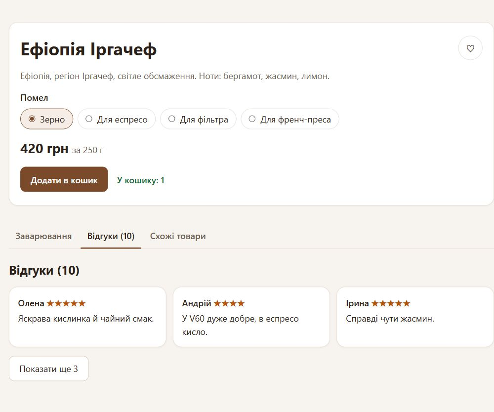

# ЛР-8. children, складені компоненти й HOC

Тема листа: `[React] ЛР-8: children, складені компоненти й HOC`

GitHub repository: https://github.com/andriihnatenko-ux/react-labs/tree/main/lab-8

Vercel: <!-- TODO: вставити адресу після деплою, Root Directory — lab-8 -->

## 1. Сторінка



## 2. Що було не так і що змінено

### Вкладки: вміст через children, стан через контекст

`ProductTabs` сам імпортував три розділи й рендерив лише активний, тому
перемикання вкладки розмонтовувало панель разом із таймером. Я замінив його на
складений `Tabs` (`Tabs.List`, `Tabs.Tab`, `Tabs.Panel`): `App` передає вміст
панелей як `children`, `Tabs` зберігає обрану вкладку в стані й віддає її
частинам через контекст, а невибрані панелі лишаються в DOM з атрибутом
`hidden`. Тепер таймер іде далі, поки відкрита інша вкладка, а панелі не
рендеряться повторно під час перемикання. `ProductTabs.jsx` видалено.

### Доступні вкладки за ARIA APG

Вкладки були звичайними кнопками без ролей і клавіатури. Я додав `role="tablist"`,
`role="tab"`, `role="tabpanel"`, `aria-selected`, `aria-controls`,
`aria-labelledby`, унікальні `id` з `useId` і `tabIndex={0}` для панелі.
Реалізовано roving tabindex та автоматичну активацію: `→`, `←`, `Home`, `End`
переносять фокус і одразу обирають вкладку, а `Home`/`End` не прокручують
сторінку.

### withAnalytics

HOC повертав компонент без змін, тож подій не було. Тепер
`withAnalytics(Component, event)` рендерить обгорнутий компонент з тими самими
props, під час кліку викликає `track(event, analyticsData)`, а потім зовнішній
`onClick`; `analyticsData` не потрапляє в DOM, `ref` у React 19 проходить як
звичайний проп, а `displayName` має вигляд `withAnalytics(Button)`. «Додати в
кошик» обгорнуто на рівні модуля й надсилає `add_to_cart` з `{ productId }`.

### Кнопка таймера, яка втрачає фокус

`TimerView` створював HOC під час рендеру (`const PrimaryButton = withAnalytics(...)`),
тому кожен рендер давав новий тип компонента, React перемонтовував кнопку, і
фокус зникав. Я виніс `PrimaryButton` на рівень модуля й передав дані події
пропсом: одна подія `timer_control` з `{ method, action }`, де `action` —
`start`, `pause`, `resume` або `restart`. Це також прибрало помилку ESLint
`react-hooks/static-components`.

## 3. Перевірки

`npx vitest run` — 28 тестів з 28:

```
 Test Files  4 passed (4)
      Tests  28 passed (28)
```

`npm run lint` — без помилок і попереджень, `npm run format:check` — усі файли
відформатовані, `npm run build` — успішний:

```
> lab-8@0.0.0 lint
> eslint .

> lab-8@0.0.0 format:check
> prettier . --check

Checking formatting...
All matched files use Prettier code style!

vite v8.3.8 building client environment for production...
✓ 34 modules transformed.
dist/index.html                   0.48 kB │ gzip:  0.33 kB
dist/assets/index-BFDdO6-i.css    4.16 kB │ gzip:  1.35 kB
dist/assets/index-CnRppqbS.js   229.51 kB │ gzip: 72.41 kB
✓ built in 136ms
```

## 4. Історія комітів

```
chore: add lab 8 starter
feat: pass the tab content to Tabs as children
feat: make the tabs accessible
feat: track clicks with the withAnalytics HOC
fix: keep the timer button focused
```

Файли в `tests/` не змінювалися після коміту стартового проєкту:
`git log --oneline -- lab-8/tests` показує лише `chore: add lab 8 starter`.

## 5. Використання AI

Використовував AI-агента OpenCode (модель DeepSeek V4.1 Flash Free) 18 листопада
2026 року. AI допомагав писати код усіх чотирьох challenges: складеного `Tabs` із
контекстом і панелями через `hidden`, ARIA-ролей і клавіатурної навігації, HOC
`withAnalytics` і виправлення `TimerView`. Також з AI розбирав помилки: чому
`react-hooks/static-components` скаржиться на HOC, створений під час рендеру, і
чому через це кнопка таймера втрачає фокус; читав повідомлення тестів Vitest.
AI запускав `npx vitest run`, `npm run lint`, `npm run format:check` і
`npm run build`, перевіряв сторінку в браузері (таймер між вкладками, клавіатура,
події в Console), робив коміти й підготував чернетку цього звіту.

## 6. Висновок

Найскладніше було зрозуміти, чому HOC, створений під час рендеру, змінює тип
компонента й перемонтовує кнопку: тест на фокус падав саме через це, а не через
сам `withAnalytics`. Другий неочевидний момент — зберегти стан панелі, не
рендерячи її повторно: допомогло те, що вміст передає `App` як `children`, а
`Tabs` лише ховає панель атрибутом `hidden`.
